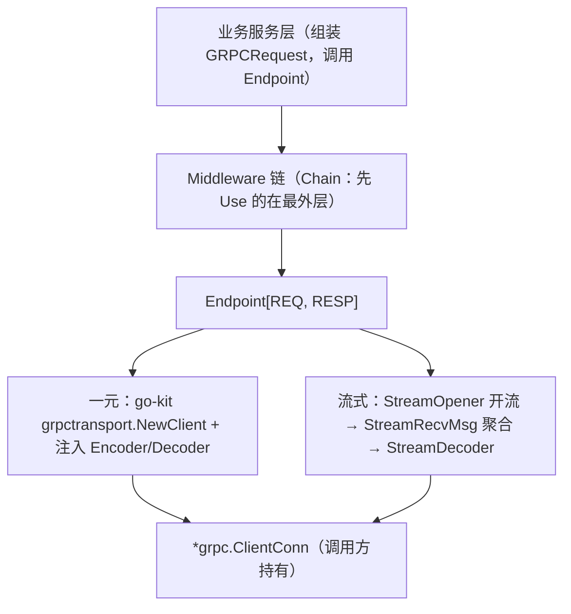

# client-sdk/grpc/v1：领域类型 gRPC 客户端 SDK

## 库定位与适用场景

`pkg/client-sdk/grpc/v1` 提供泛型 gRPC 客户端：对外只暴露**领域类型的一元
Endpoint**，protobuf 编解码显式注入；服务端流式 RPC 由传输层透明聚合
（收齐全部分块 → 拼接字节 → 一次性解码），调用方无需感知流。

适用场景：

- 为业务项目构建分层客户端 SDK（参考 [examples/grpcclient](../../../../examples/grpcclient/doc.go)）；
- 需要客户端侧中间件（日志、重试、鉴权头注入等）装饰调用链；
- 消费 [framework/grpc](generic_server_framework_grpc.md) 服务端的一元与
  服务端流式 RPC。

## 安装与导入路径

```bash
go get github.com/ClessLi/component-base
```

```go
import grpcclientv1 "github.com/ClessLi/component-base/pkg/client-sdk/grpc/v1"
```

## 核心概念与架构



- **GRPCRequest[REQ]**：`{Metadata map[string][]string; Body REQ}`，Metadata 经
  `metadata.NewOutgoingContext` 注入；一元路径额外用
  `ClientBefore(preserveOutgoingMD)` 保住 go-kit 重建出站 metadata 时丢失的头。
- **编解码注入**：pb 消息无法像 JSON 自动序列化，一元需
  `Encoder[REQ, ProtoReq]` + `Decoder[ProtoResp, RESP]` + reply 实例；
  流式需 `StreamOpener[REQ]` + `MsgExtractor[ProtoMsg]` + `StreamDecoder[RESP]`。
- **流式透明聚合**：`StreamRecvMsg` 循环 `RecvMsg` 直到 `io.EOF`，把每块
  extractor 取出的字节拼接为完整 `[]byte`，再交 StreamDecoder 解码。

## 关键类型与函数清单

### client.go

| 签名                                                                                                                                                                                                                                                                | 说明                                            |
|-------------------------------------------------------------------------------------------------------------------------------------------------------------------------------------------------------------------------------------------------------------------|-----------------------------------------------|
| `type Client[REQ, RESP any] interface { Endpoint() Endpoint[REQ, RESP] }`                                                                                                                                                                                         | 对外客户端接口                                       |
| `type ClientBuilder[REQ, RESP any] interface { Use(Middleware[REQ, RESP]) ClientBuilder[REQ, RESP]; UseMany(...Middleware[REQ, RESP]) ClientBuilder[REQ, RESP]; WithOptions(...grpctransport.ClientOption) ClientBuilder[REQ, RESP]; Build() Client[REQ, RESP] }` | 流式构造器                                         |
| `func NewUnaryClientBuilder[REQ, RESP, ProtoReq, ProtoResp any](conn *grpc.ClientConn, service, method string, encoder Encoder[REQ, ProtoReq], decoder Decoder[ProtoResp, RESP], reply ProtoResp) ClientBuilder[REQ, RESP]`                                       | 一元构造器；service/method 拼为 `/<service>/<method>` |
| `func NewStreamClientBuilder[REQ, RESP, ProtoMsg any](conn *grpc.ClientConn, service, method string, opener StreamOpener[REQ], extractor MsgExtractor[ProtoMsg], decoder StreamDecoder[RESP]) ClientBuilder[REQ, RESP]`                                           | 服务端流式构造器（对外仍是一元 Endpoint）                     |
| `func NewUnaryClient[REQ, RESP, ProtoReq, ProtoResp any](conn *grpc.ClientConn, service, method string, encoder Encoder[REQ, ProtoReq], decoder Decoder[ProtoResp, RESP], reply ProtoResp, options ...grpctransport.ClientOption) Client[REQ, RESP]`              | 一元便捷构造（Builder + WithOptions + Build）         |
| `func NewStreamClient[REQ, RESP, ProtoMsg any](conn *grpc.ClientConn, service, method string, opener StreamOpener[REQ], extractor MsgExtractor[ProtoMsg], decoder StreamDecoder[RESP], options ...grpctransport.ClientOption) Client[REQ, RESP]`                  | 流式便捷构造                                        |

### endpoint.go、encoder.go、decoder.go、metadata.go、middleware.go

| 签名                                                                                                            | 说明                                      |
|---------------------------------------------------------------------------------------------------------------|-----------------------------------------|
| `type Endpoint[REQ, RESP any] func(ctx context.Context, request GRPCRequest[REQ]) (response RESP, err error)` | 领域类型端点                                  |
| `func NewEndpoint[REQ, RESP any](ep endpoint.Endpoint) Endpoint[REQ, RESP]`                                   | 适配 go-kit endpoint；响应为 nil 时返回零值；断言失败报错 |
| `type Encoder[REQ, ProtoReq any] func(ctx context.Context, req REQ) (ProtoReq, error)`                        | 领域请求 → pb 请求（服务端 Decoder 的对偶）           |
| `type Decoder[ProtoResp, RESP any] func(ctx context.Context, resp ProtoResp) (RESP, error)`                   | pb 响应 → 领域响应                            |
| `type StreamDecoder[RESP any] func(ctx context.Context, data []byte) (RESP, error)`                           | 聚合后的完整字节 → 领域响应                         |
| `type GRPCRequest[REQ any] struct { Metadata map[string][]string; Body REQ }`                                 | 出站元数据 + 请求体                             |
| `type Middleware[REQ, RESP any] func(Endpoint[REQ, RESP]) Endpoint[REQ, RESP]`                                | 端点装饰器                                   |
| `func Chain[REQ, RESP any](middlewares ...Middleware[REQ, RESP]) Middleware[REQ, RESP]`                       | 依序组合，**第一个在最外层**                        |

### stream_recv.go

| 签名                                                                                                             | 说明                            |
|----------------------------------------------------------------------------------------------------------------|-------------------------------|
| `type MsgExtractor[ProtoMsg any] func(msg ProtoMsg) []byte`                                                    | 从流消息取字节（服务端 MsgAssembler 的对偶） |
| `type StreamOpener[REQ any] func(ctx context.Context, req REQ) (grpc.ClientStream, error)`                     | 开流函数，通常包装 pb 生成的客户端方法         |
| `func StreamRecvMsg[ProtoMsg any](stream grpc.ClientStream, extractor MsgExtractor[ProtoMsg]) ([]byte, error)` | 收齐全部消息并拼接字节                   |

`StreamRecvMsg` 边界行为：

- extractor 为 nil → 报错；`ProtoMsg` 必须是**指针类型**（反射校验），否则报错；
- 每次接收前检查 `stream.Context().Err()`（取消/超时立即返回）；
- 每轮用反射新建 ProtoMsg 实例接收；`io.EOF` 正常结束并返回聚合数据；
  其他接收错误原样返回。

### mock_client.go（mockgen 生成）

`MockClient[REQ, RESP]` / `MockClientBuilder[REQ, RESP]` 及
`NewMockClient` / `NewMockClientBuilder`（gomock），供上层单测注入。

## 配置项说明

无 Options 结构。可配置点：

| 配置                                           | 默认       | 说明                                   |
|----------------------------------------------|----------|--------------------------------------|
| `WithOptions(...grpctransport.ClientOption)` | 无        | **仅一元路径生效**（流式 endpoint 不消费 options） |
| `Use/UseMany` 中间件                            | 无        | Build 时经 Chain 组合                    |
| `*grpc.ClientConn`                           | 调用方创建并持有 | SDK 不负责拨号与关闭                         |

## 最小可运行示例（一元）

```go
conn, err := grpc.NewClient("127.0.0.1:8081",
grpc.WithTransportCredentials(insecure.NewCredentials()))
if err != nil { /* ... */ }
defer conn.Close()

client := grpcclientv1.NewUnaryClient[string, string, *pbv1.EchoRequest, *pbv1.EchoResponse](
conn, "grpcserverpb.Demo", "Echo",
func (ctx context.Context, msg string) (*pbv1.EchoRequest, error) {
return &pbv1.EchoRequest{Message: msg}, nil
},
func (ctx context.Context, resp *pbv1.EchoResponse) (string, error) {
return resp.GetMessage(), nil
},
&pbv1.EchoResponse{}, // reply 实例
)

resp, err := client.Endpoint()(ctx, grpcclientv1.GRPCRequest[string]{
Metadata: map[string][]string{"authorization": {"Bearer xxx"}},
Body:     "hello",
})
```

## 进阶示例

### 服务端流式下载（真实示例）

改写自 [examples/grpcclient/transport/demo.go](../../../../examples/grpcclient/transport/demo.go)：

```go
downloadClient := grpcclientv1.NewStreamClientBuilder[string, []byte, *pbv1.Chunk](
conn, "grpcserverpb.Demo", "Download",
func (ctx context.Context, key string) (grpc.ClientStream, error) {
return pbv1.NewDemoClient(conn).Download(ctx, &pbv1.DownloadRequest{Key: key})
},
(*pbv1.Chunk).GetData, // MsgExtractor：方法表达式
func (ctx context.Context, data []byte) ([]byte, error) { return data, nil }, // StreamDecoder
).Build()

data, err := downloadClient.Endpoint()(ctx, grpcclientv1.GRPCRequest[string]{Body: "greeting"})
// data 为全部分块聚合后的完整字节，调用方无流感知
```

### 客户端中间件

```go
func loggingMiddleware() grpcclientv1.Middleware[string, string] {
return func (next grpcclientv1.Endpoint[string, string]) grpcclientv1.Endpoint[string, string] {
return func (ctx context.Context, req grpcclientv1.GRPCRequest[string]) (string, error) {
logV1.Debugf("outgoing Echo message=%q", req.Body)
return next(ctx, req)
}
}
}

client := grpcclientv1.NewUnaryClientBuilder[string, string, *pbv1.EchoRequest, *pbv1.EchoResponse](
conn, "grpcserverpb.Demo", "Echo", enc, dec, &pbv1.EchoResponse{},
).Use(loggingMiddleware()).Build()
```

### 分层 SDK 组织

完整的 transport（含 encoder/decoder 子包）→ endpoint → service → client 四层
组织与 Config 驱动构造见 [examples/grpcclient](../../../../examples/grpcclient/doc.go)。

## 与其他库的协作关系

- **[framework/grpc](generic_server_framework_grpc.md)**：Encoder/Decoder 与服务端
  Decoder/Encoder 互为对偶；MsgExtractor 对偶 MsgAssembler；流式聚合与服务端
  StreamSendMsg 分块协议配套。
- **[client-sdk/http](client_sdk_http.md)**：同构 API 面（Client/Builder/Chain），
  差异仅在编解码注入与请求载体（GRPCRequest vs HTTPRequest）。
- **[utils](utils.md)**：NewEndpoint 用 `utils.IsNil` 判空响应。
- **[errors](errors.md)**：类型断言/参数错误经 errors 包构造。

## 注意事项、限制与常见问题

1. **仅一元对外**：流式 RPC 被聚合为一次性响应，大响应整体驻留内存；channel 增量
   消费（`StreamRecvChan`/`StreamClient`）在源码中标记 TODO(channel-transport)，
   **尚未实现**。客户端流式/双向流式无封装（待确认）。
2. **StreamOpener 必须返回 grpc.ClientStream**：pb 生成的客户端流内嵌
   ClientStream 而非 ServerStream，签名写成 ServerStream 会编译失败。
3. **WithOptions 对流式无效**：流式 endpoint 不经 go-kit client，options 被忽略。
4. **ProtoMsg 必须是指针类型**：如 `*pbv1.Chunk`；值类型会被 StreamRecvMsg 拒绝。
5. **conn 生命周期归调用方**：SDK 不拨号不关闭；示例客户端以 Close 封装 conn.Close。
6. **service 名是 proto 服务全名**：如 `grpcserverpb.Demo`，与服务端 RA 注册名
   （带前缀）无关，后者仅是健康检查/注册键。
7. **测试**：`go test -race ./pkg/client-sdk/grpc/... ./examples/grpcclient/...`
   （由使用者自行执行；示例测试会自动拉起 grpcserver 做回环验证）。