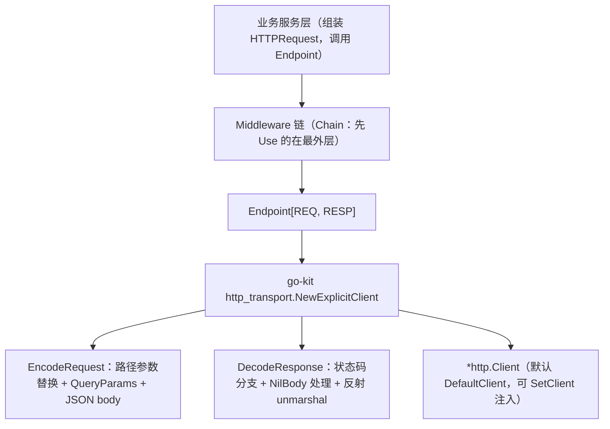

# client-sdk/http/v1：领域类型 HTTP 客户端 SDK

## 库定位与适用场景

`pkg/client-sdk/http/v1` 提供泛型 HTTP 客户端：对外只暴露**领域类型的
Endpoint**，JSON 编解码内置；支持 `:param` 路径参数替换、查询参数注入、
`NilBody` 空请求/响应体占位，以及客户端侧中间件装饰。

适用场景：

- 为业务项目构建分层客户端 SDK（参考 [examples/httpclient](../../../../examples/httpclient/doc.go)）；
- 消费 [framework/http](generic_server_framework_http.md) 或任意 JSON API，
  并自动把非 200 错误响应还原为带错误码的 [errors](errors.md) 错误；
- 需要客户端侧中间件（日志、鉴权头注入、重试等）装饰调用链。

## 安装与导入路径

```bash
go get github.com/ClessLi/component-base
```

```go
import httpclientv1 "github.com/ClessLi/component-base/pkg/client-sdk/http/v1"
```

## 核心概念与架构



- **HTTPRequest[REQ]**：`{PathVars map[string]string; QueryParams map[string][]string; Body REQ}`，
  一个载体同时描述路径变量、查询参数与请求体。
- **NilBody 占位设计**：GET/DELETE 等无请求体、或 204 类无响应体的操作，
  用 `NilBody`（`struct{}`）作泛型实参，编解码两侧据此跳过 body 处理，
  避免为「空」定义 nil 语义混乱的指针类型。
- **错误还原**：非 200 且响应体为 [core.ErrResponse](core.md) JSON 时，
  解码为 `errors.WithCode(Namespace, Code, Message)`，客户端拿到的错误
  与服务端 Coder 注册码同构。

## 关键类型与函数清单

### client.go

| 签名                                                                                                                                                                                                                                                                     | 说明                                                                        |
|------------------------------------------------------------------------------------------------------------------------------------------------------------------------------------------------------------------------------------------------------------------------|---------------------------------------------------------------------------|
| `type Client[REQ any, RESP any] interface { Endpoint() Endpoint[REQ, RESP] }`                                                                                                                                                                                          | 对外客户端接口                                                                   |
| `type ClientBuilder[REQ any, RESP any] interface { Use(Middleware[REQ, RESP]) ClientBuilder[REQ, RESP]; UseMany(...Middleware[REQ, RESP]) ClientBuilder[REQ, RESP]; WithOptions(...http_transport.ClientOption) ClientBuilder[REQ, RESP]; Build() Client[REQ, RESP] }` | 流式构造器                                                                     |
| `func NewClientBuilder[REQ any, RESP any](method, path string) ClientBuilder[REQ, RESP]`                                                                                                                                                                               | path 须为**完整 URL**（内部 `http.NewRequest(method, path, nil)`），可含 `:param` 占位 |
| `func NewHTTPClient[REQ any, RESP any](method, path string, options ...http_transport.ClientOption) Client[REQ, RESP]`                                                                                                                                                 | 便捷构造（Builder + WithOptions + Build）                                       |

### endpoint.go、middleware.go

| 签名                                                                                                                | 说明                                      |
|-------------------------------------------------------------------------------------------------------------------|-----------------------------------------|
| `type Endpoint[REQ any, RESP any] func(ctx context.Context, request HTTPRequest[REQ]) (response RESP, err error)` | 领域类型端点                                  |
| `func NewEndpoint[REQ any, RESP any](ep endpoint.Endpoint) Endpoint[REQ, RESP]`                                   | 适配 go-kit endpoint；响应为 nil 时返回零值；断言失败报错 |
| `type Middleware[REQ any, RESP any] func(Endpoint[REQ, RESP]) Endpoint[REQ, RESP]`                                | 端点装饰器                                   |
| `func Chain[REQ any, RESP any](middlewares ...Middleware[REQ, RESP]) Middleware[REQ, RESP]`                       | 依序组合，**第一个在最外层**                        |

### metadata.go

| 签名                                                                                                           | 说明          |
|--------------------------------------------------------------------------------------------------------------|-------------|
| `type HTTPRequest[REQ any] struct { PathVars map[string]string; QueryParams map[string][]string; Body REQ }` | 请求载体        |
| `type NilBody struct{}`                                                                                      | 空请求/响应体占位类型 |
| 常量 `HTTPMethodPost = "POST"`、`HTTPMethodGet = "GET"`、`HTTPMethodPut = "PUT"`、`HTTPMethodDelete = "DELETE"`   | HTTP 方法常量   |

### encoder.go

| 签名                                                                                                    | 说明                            |
|-------------------------------------------------------------------------------------------------------|-------------------------------|
| `func EncodeRequest[REQ any](ctx context.Context, request *http.Request, req HTTPRequest[REQ]) error` | 组装出站请求（通常由 Build 内部调用，也可单独复用） |

编码流程：

1. **路径参数**：正则 `:([a-zA-Z0-9_\-]+)` 找出全部 `:param` 占位，逐个从
   `req.PathVars` 取值替换；**缺失键或空字符串值都直接报错**；
2. **查询参数**：`req.QueryParams` 逐键逐值 `query.Add`（追加而非覆盖 URL
   已有同名参数）；
3. **请求体**：双重判空 `!isNilBody[REQ]() && !utils.IsNil(req.Body)` 通过后
   才 `json.Marshal` 写入 body；NilBody 类型或 nil 值均跳过（不发 body）。

### decoder.go

| 签名                                                                                                 | 说明                   |
|----------------------------------------------------------------------------------------------------|----------------------|
| `func DecodeResponse[RESP any](ctx context.Context, response *http.Response) (interface{}, error)` | 解码响应（通常由 Build 内部调用） |

解码分支（按判定顺序）：

| 条件                                 | 行为                                                                                                                                |
|------------------------------------|-----------------------------------------------------------------------------------------------------------------------------------|
| body 为空且状态码非 200                   | 返回 `errors.New(response.Status)`                                                                                                  |
| body 为空且 200                       | 返回 `nil, nil`                                                                                                                     |
| 非 200 且有 body                      | 按 `core.ErrResponse` unmarshal，返回 `errors.WithCode(errResp.Namespace, errResp.Code, errResp.Message)`；unmarshal 失败则 Wrap 报错并附原始报文 |
| `RESP` 为 NilBody 且 body 为 `"null"` | 返回 `nil, nil`（正常空响应）                                                                                                              |
| `RESP` 为 NilBody 但 body 非空         | 报错 `"response declared as NilBody type but actual response body is not empty"`                                                    |
| 其余                                 | 反射按 RESP 指针/非指针类型新建实例并 `json.Unmarshal`                                                                                           |

### mock_client.go（mockgen 生成）

`MockClient[REQ, RESP]` / `MockClientBuilder[REQ, RESP]` 及
`NewMockClient` / `NewMockClientBuilder`（gomock），供上层单测注入。

## 配置项说明

无 Options 结构。可配置点：

| 配置                                            | 默认        | 说明                                                                                         |
|-----------------------------------------------|-----------|--------------------------------------------------------------------------------------------|
| `WithOptions(...http_transport.ClientOption)` | go-kit 默认 | 常用 `http_transport.SetClient(&http.Client{...})` 注入超时/Transport；不设置时用 `http.DefaultClient` |
| `Use/UseMany` 中间件                             | 无         | Build 时经 Chain 组合                                                                          |
| method/path                                   | 必填        | path 为完整 URL，构建时固定，运行期只替换 `:param` 与追加 query                                               |

## 最小可运行示例

```go
// POST：有请求体
createClient := httpclientv1.NewHTTPClient[*apiv1.CreateUserRequest, *apiv1.User](
	httpclientv1.HTTPMethodPost, "http://127.0.0.1:8080/v1/users")

user, err := createClient.Endpoint()(ctx, httpclientv1.HTTPRequest[*apiv1.CreateUserRequest]{
	Body: &apiv1.CreateUserRequest{Name: "alice"},
})

// GET：无请求体用 NilBody 占位，路径参数经 PathVars 注入
getClient := httpclientv1.NewHTTPClient[httpclientv1.NilBody, *apiv1.User](
	httpclientv1.HTTPMethodGet, "http://127.0.0.1:8080/v1/users/:id")

user, err = getClient.Endpoint()(ctx, httpclientv1.HTTPRequest[httpclientv1.NilBody]{
	PathVars: map[string]string{"id": user.ID},
})
```

域类型 `apiv1.CreateUserRequest` / `apiv1.User` 来自
[examples/apiserver/api/v1](../../../../examples/apiserver/api/v1/types.go)，
与 apiserver 服务端共用同一套领域结构。

## 进阶示例

### Builder + 中间件 + 自定义 http.Client

改写自 [examples/httpclient/transport/user.go](../../../../examples/httpclient/transport/user.go)：

```go
func loggingCreateMiddleware() httpclientv1.Middleware[*apiv1.CreateUserRequest, *apiv1.User] {
	return func(next httpclientv1.Endpoint[*apiv1.CreateUserRequest, *apiv1.User]) httpclientv1.Endpoint[*apiv1.CreateUserRequest, *apiv1.User] {
		return func(ctx context.Context, request httpclientv1.HTTPRequest[*apiv1.CreateUserRequest]) (*apiv1.User, error) {
			logV1.Debugf("httpclient: POST /v1/users name=%q", request.Body.Name)
			return next(ctx, request)
		}
	}
}

createClient := httpclientv1.NewClientBuilder[*apiv1.CreateUserRequest, *apiv1.User](
	httpclientv1.HTTPMethodPost, baseURL+"/v1/users",
).
	Use(loggingCreateMiddleware()).
	WithOptions(http_transport.SetClient(&http.Client{Timeout: 10 * time.Second})).
	Build()
```

### 查询参数（List）

```go
listClient := httpclientv1.NewHTTPClient[httpclientv1.NilBody, []*apiv1.User](
	httpclientv1.HTTPMethodGet, baseURL+"/v1/users")

users, err := listClient.Endpoint()(ctx, httpclientv1.HTTPRequest[httpclientv1.NilBody]{
	QueryParams: map[string][]string{"offset": {"0"}, "limit": {"10"}},
})
```

### 分层 SDK 组织

完整的 transport → endpoint → service → client 四层组织见
[examples/httpclient](../../../../examples/httpclient/doc.go)（构造器命名为
`NewTransport`/`NewEndpoint`/`NewService`/`NewClient`）。

## 与其他库的协作关系

- **[core](core.md)**：非 200 响应按 `core.ErrResponse` 解析；与
  framework/http 服务端 `core.WriteResponse` 的错误报文格式配套。
- **[errors](errors.md)**：decoder 用本仓库 errors 包还原错误码
  （`errors.WithCode`）；**encoder 用外部 `marmotedu/errors`**（见注意事项）。
- **[utils](utils.md)**：body 判空用 `utils.IsNil`；NewEndpoint 判空响应同理。
- **[client-sdk/grpc](client_sdk_grpc.md)**：同构 API 面
  （Client/Builder/Chain/Endpoint），差异在请求载体（HTTPRequest vs
  GRPCRequest）与编解码（JSON 内置 vs pb 显式注入）。
- **[framework/http](generic_server_framework_http.md)**：对端服务端；
  路径参数 `:param` 写法与 gin 路由一致。

## 注意事项、限制与常见问题

1. **path 必须是完整 URL**：含 scheme 与 host（`http.NewRequest` 语义），
   只写 `/v1/users` 会在请求发送时报错；baseURL 拼接由调用方负责。
2. **路径参数强校验**：`:param` 占位缺失对应 PathVars 键、或值为空串都会
   报错，不会静默保留占位符发出请求。
3. **NilBody 按类型名字符串比较**：`isNilBody` 用反射 `Type.String()` 对比，
   其他包中恰好命名为 `NilBody` 的同构类型会被误判为空体类型；请始终使用
   本包的 `httpclientv1.NilBody`。
4. **RESP 声明为 NilBody 但服务端返回非空 body 会报错**：这是有意的契约
   校验；若接口可能返回内容，不要声明 NilBody。
5. **仅支持 JSON**：编解码硬编码 `json.Marshal/Unmarshal`，不支持表单、
   protobuf 等其他内容类型（待确认是否有扩展计划）。
6. **错误包混用**：encoder.go 用 `marmotedu/errors`（构造参数/序列化错误，
   无本仓库错误码）；decoder.go/client.go/endpoint.go 用本仓库 errors 包。
   上层做码值判断时只对 decoder 还原的业务错误有效。
7. **QueryParams 是追加语义**：URL 中已写死的同名 query 参数不会被覆盖，
   而是多值并存。
8. **测试**：`go test -race ./pkg/client-sdk/http/... ./examples/httpclient/...`
   （由使用者自行执行；示例测试会自动拉起 apiserver 做回环验证）。