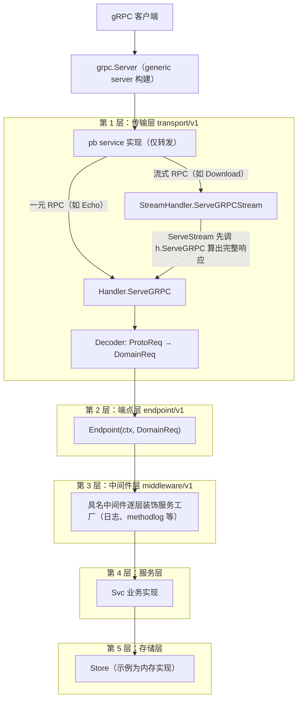
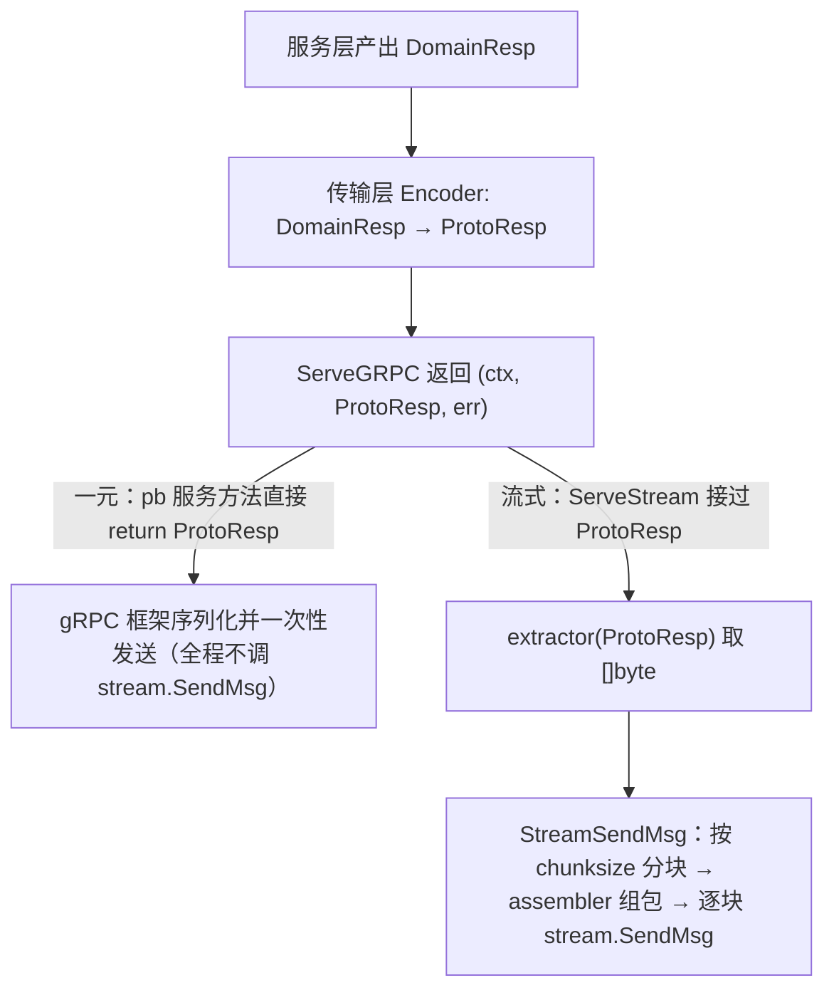
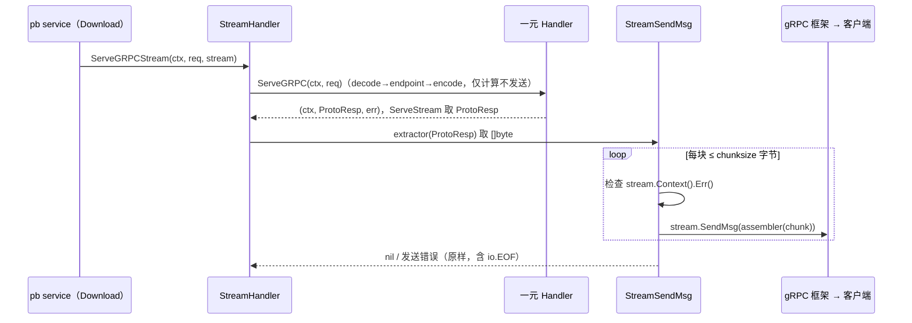

# generic_server framework/grpc：类型安全的 gRPC 分层框架（含流式）

## 库定位与适用场景

`pkg/generic_server/framework/grpc` 提供 gRPC 服务端的四个分层契约包：
`endpoint/v1`（端点）、`middleware/v1`（服务中间件）、`service_register/v1`
（服务注册声明）、`transport/v1`（一元 Handler + 服务端流式工具）。
设计参考 go-kit，用泛型固定「protobuf 类型 ↔ 领域类型」的转换链路。

适用场景：

- 一元 RPC：decode → endpoint → encode 三段独立可测；
- 服务端流式 RPC：「计算完整响应 + 分块发送」管线（如文件下载）；
- 业务只声明注册什么服务，健康状态流转等控制流程由框架统一执行。

## 安装与导入路径

```bash
go get github.com/ClessLi/component-base
```

```go
import (
epv1 "github.com/ClessLi/component-base/pkg/generic_server/framework/grpc/endpoint/v1"
mwv1 "github.com/ClessLi/component-base/pkg/generic_server/framework/grpc/middleware/v1"
svcregisterv1 "github.com/ClessLi/component-base/pkg/generic_server/framework/grpc/service_register/v1"
transportv1 "github.com/ClessLi/component-base/pkg/generic_server/framework/grpc/transport/v1"
)
```

## 核心概念与分层架构

请求路径：五层自上而下，中间件层在构造期装饰服务工厂，运行期请求逐层穿过：



响应回程：服务层产出 DomainResp 后，由传输层 Encoder 编码；`ServeGRPC`
返回处按 RPC 形态分叉为两条发送路径（共用部分仅限计算，计算管线内不发送
任何数据）：



**共用部分仅限「计算响应」，发送方式不同**：

|        | 一元 RPC                                                             | 服务端流式 RPC                                                                                    |
|--------|--------------------------------------------------------------------|----------------------------------------------------------------------------------------------|
| 计算阶段   | `ServeGRPC`：decode → endpoint → encode                             | 同左（`ServeStream` 内部调 `h.ServeGRPC`）                                                          |
| 计算结果去向 | 返回 `(ctx, ProtoResp, err)`，pb 服务方法直接 `return resp, nil` 交给 gRPC 框架 | `ServeStream` 丢弃 ctx（`_, resp, err := h.ServeGRPC(...)`），取 ProtoResp 继续处理                    |
| 发送方式   | gRPC 框架序列化 ProtoResp 一次性发送，**全程不调 `stream.SendMsg`**               | `extractor(resp)` 取字节 → `StreamSendMsg` 按 chunksize 分块，逐块 `stream.SendMsg(assembler(chunk))` |
| 发送错误处理 | `ServeGRPC` 内部 `errors.Wrap` 后随返回值交给 gRPC                          | `SendMsg` 错误原样返回（含 `io.EOF`）                                                                 |

源码依据：[handler.go](../../../../pkg/generic_server/framework/grpc/transport/v1/handler.go)
L29-67（`ServeGRPC` 只计算并返回，无任何发送调用）、
[stream_handler.go](../../../../pkg/generic_server/framework/grpc/transport/v1/stream_handler.go)
L88-93（先 `h.ServeGRPC` 后 `StreamSendMsg`）、
[stream_send.go](../../../../pkg/generic_server/framework/grpc/transport/v1/stream_send.go)
L26-40（分块循环内调 `stream.SendMsg`）；对照
[examples/grpcserver/transport.go](../../../../examples/grpcserver/transport.go)
L49-61：`Echo` 直接 `return resp, nil`，`Download` 仅转发 stream。

流式时序（`ServeGRPCStream`；一元 RPC 不进入此时序，`ServeGRPC` 返回后由
pb 服务方法直接 return 给 gRPC 框架）：



## 关键类型与函数清单

### endpoint/v1/endpoint.go、middleware/v1/middleware.go

与 [framework/http](generic_server_framework_http.md) 同签名：

| 签名                                                                                                                       | 说明       |
|--------------------------------------------------------------------------------------------------------------------------|----------|
| `type Endpoint[DomainReq, DomainResp any] func(ctx context.Context, request DomainReq) (response DomainResp, err error)` | 端点函数     |
| `type Middleware[Svc any] func(factory Svc) Svc`                                                                         | 服务工厂装饰器  |
| `type Middlewares[Svc any] map[string]Middleware[Svc]`                                                                   | 具名中间件注册表 |

### service_register/v1/service_register.go

| 签名                                                                                                                       | 说明                                                                                      |
|--------------------------------------------------------------------------------------------------------------------------|-----------------------------------------------------------------------------------------|
| `type ServiceRegister func(server *grpc.Server, healthzSvr *health.Server)`                                              | 底层注册契约，由 generic server 消费，业务不应手工构造                                                     |
| `type ServiceRegistration struct { Name string; Register func(server *grpc.Server) }`                                    | 业务声明：服务名（兼作健康检查键与 RA 注册名）+ 仅挂载实现的注册函数                                                   |
| `func NewServiceRegistration[T any](name string, impl T, register func(server *grpc.Server, srv T)) ServiceRegistration` | 由 pb 生成的 `RegisterXxxServer` 与实现直接构造声明                                                  |
| `func GenerateServiceRegisters(registrations ...ServiceRegistration) map[string]ServiceRegister`                         | 统一控制流程：置 NOT_SERVING → 挂载实现 → 置 SERVING；空名或 nil Register 的声明跳过；healthzSvr 为 nil 时跳过状态设置 |

### transport/v1 一元（decoder.go、encoder.go、handler.go）

| 签名                                                                                                                                                                                                                    | 说明                              |
|-----------------------------------------------------------------------------------------------------------------------------------------------------------------------------------------------------------------------|---------------------------------|
| `type Decoder[ProtoReq, DomainReq any] func(ctx context.Context, r ProtoReq) (DomainReq, error)`                                                                                                                      | protobuf 请求 → 领域请求              |
| `type Encoder[DomainResp, ProtoResp any] func(ctx context.Context, r DomainResp) (ProtoResp, error)`                                                                                                                  | 领域响应 → protobuf 响应              |
| `type Handler[ProtoReq, ProtoResp any] interface { ServeGRPC(ctx context.Context, request ProtoReq) (context.Context, ProtoResp, error) }`                                                                            | 一元处理器接口（go-kit grpc handler 形态） |
| `func NewHandler[ProtoReq, DomainReq, DomainResp, ProtoResp any](ep epv1.Endpoint[DomainReq, DomainResp], decoder Decoder[ProtoReq, DomainReq], encoder Encoder[DomainResp, ProtoResp]) Handler[ProtoReq, ProtoResp]` | 组装一元处理器                         |

`ServeGRPC` 内部每次调用构造 go-kit `grpc.NewServer`，三段均做类型断言，断言失败返回
`errors.Errorf`；管线出错时返回零值 ProtoResp 并 `errors.Wrap(err, "grpc server handler failed")`。

### transport/v1 流式（stream_send.go、stream_handler.go）

| 签名                                                                                                                                                                                                                                                                                                                            | 说明                    |
|-------------------------------------------------------------------------------------------------------------------------------------------------------------------------------------------------------------------------------------------------------------------------------------------------------------------------------|-----------------------|
| `type MsgAssembler[ProtoMsg any] func(msg []byte) ProtoMsg`                                                                                                                                                                                                                                                                   | 把一块字节组装为流消息           |
| `func StreamSendMsg[ProtoMsg any](stream grpc.ServerStream, data []byte, chunksize int, assembler MsgAssembler[ProtoMsg]) error`                                                                                                                                                                                              | 分块发送原语                |
| `type StreamHandler[ProtoReq, ProtoMsg any] interface { ServeGRPCStream(ctx context.Context, request ProtoReq, stream grpc.ServerStream) error }`                                                                                                                                                                             | 流式处理器接口               |
| `func NewStreamHandler[ProtoReq, DomainReq, DomainResp, ProtoResp, ProtoMsg any](ep epv1.Endpoint[DomainReq, DomainResp], decoder Decoder[ProtoReq, DomainReq], encoder Encoder[DomainResp, ProtoResp], chunksize int, extractor func(ProtoResp) []byte, assembler MsgAssembler[ProtoMsg]) StreamHandler[ProtoReq, ProtoMsg]` | 构造期注入一元管线 + 分块参数      |
| `func ServeStream[ProtoReq, ProtoResp, ProtoMsg any](ctx context.Context, h Handler[ProtoReq, ProtoResp], req ProtoReq, stream grpc.ServerStream, chunksize int, extractor func(ProtoResp) []byte, assembler MsgAssembler[ProtoMsg]) error`                                                                                   | StreamHandler 的函数式对应物 |

`StreamSendMsg` 的边界行为（stream_send.go L18-43）：

- `chunksize <= 0` → 返回错误（防死循环）；`assembler == nil` → 返回错误；
- 每块发送前检查 `stream.Context().Err()`，客户端取消/超时立即返回；
- `SendMsg` 错误**原样返回**（含 `io.EOF`），调用方可用 `errors.Is` 判断；
- `data` 为空时不发送任何消息，返回 nil。

`ServeStream`：`h == nil` 或 `extractor == nil` → 返回错误；先经一元管线计算完整
响应，再 `StreamSendMsg(stream, extractor(resp), chunksize, assembler)`。

## 配置项说明

框架本身无 Options 结构。`chunksize` 由
[generic_server/server](generic_server_server.md) 从 `GRPCServing.ChunkSize`
（默认 1024，flag `--grpc.chunksize`，校验 ≥100）经 `InitTransport(eps, chunkSize)`
注入到 `NewStreamHandler`。

## 最小可运行示例（一元）

```go
// pb service 实现仅转发到 Handler
type demoServer struct {
pbv1.UnimplementedDemoServer
echo transportv1.Handler[*pbv1.EchoRequest, *pbv1.EchoResponse]
}

func (s *demoServer) Echo(ctx context.Context, req *pbv1.EchoRequest) (*pbv1.EchoResponse, error) {
_, resp, err := s.echo.ServeGRPC(ctx, req)
return resp, err
}

// 组装（类型链路：*EchoRequest → string → string → *EchoResponse）
echoHandler := transportv1.NewHandler(
func (ctx context.Context, msg string) (string, error) { return msg, nil }, // endpoint
func (ctx context.Context, r *pbv1.EchoRequest) (string, error) { return r.GetMessage(), nil },
func (ctx context.Context, msg string) (*pbv1.EchoResponse, error) { return &pbv1.EchoResponse{Message: msg}, nil },
)
```

## 进阶示例

### 流式下载（真实示例）

改写自 [examples/grpcserver/handler.go](../../../../examples/grpcserver/handler.go)：

```go
downloadHandler := transportv1.NewStreamHandler(
eps.Download(),         // Endpoint[string, []byte]
decodeDownloadRequest,  // *pbv1.DownloadRequest → string
encodeDownloadResponse, // []byte → *pbv1.Chunk
chunkSize,              // 由 generic server 注入
(*pbv1.Chunk).GetData, // extractor：方法表达式取响应字节
func (msg []byte) *pbv1.Chunk { // assembler：每块组包
return &pbv1.Chunk{Data: msg}
},
)

// pb service 流式方法仅转发
func (s *demoServer) Download(req *pbv1.DownloadRequest, stream pbv1.Demo_DownloadServer) error {
return s.download.ServeGRPCStream(stream.Context(), req, stream)
}
```

### 服务注册声明（真实示例）

改写自 [examples/grpcserver/register.go](../../../../examples/grpcserver/register.go)：

```go
func NewServiceRegistrations(txp Factory) []svcregisterv1.ServiceRegistration {
return []svcregisterv1.ServiceRegistration{
svcregisterv1.NewServiceRegistration(
"com.github.ClessLi.api.grpcserverpb.Demo", // 兼作健康检查键与 RA 注册名
txp.Demo(),              // pb service 实现
pbv1.RegisterDemoServer, // pb 生成的注册函数
),
}
}
```

声明交给 generic server 后由 `GenerateServiceRegisters` 统一执行
NOT_SERVING → 挂载 → SERVING，保证启动健康检查（ping 至 SERVING）通过。

## 与其他库的协作关系

- **[generic_server/server](generic_server_server.md)**：消费
  `Middlewares[Svc]`、`GRPCServerBizHooks.InitEndpoints/InitTransport/ServiceRegistrations`，
  并注入 chunkSize；注册控制流程归框架，业务 hooks 不得自行操作健康状态。
- **[methodlog](methodlog.md)**：示例服务中间件用 `GRPCFieldExtractor` 提取客户端 IP。
- **[errors](errors.md)**：类型断言失败、参数校验错误经 errors 包构造；流式发送错误
  原样透传以保持 `io.EOF` 语义。
- **[client-sdk/grpc_health](client_sdk_grpc_health.md)**：generic server 启动 ping
  用其检查各服务 SERVING 状态。

## 注意事项、限制与常见问题

1. **流式为「先算全量再分块」**：`StreamHandler` 不是增量生产模型，endpoint 返回
   完整 `[]byte` 后才开始发送；大响应会整体驻留内存。channel 驱动的增量流式
   （`StreamSendChan`/`ChanStreamHandler`）在源码中标记 TODO(channel-transport)，
   **尚未实现**。
2. **仅支持服务端流式**：客户端流式/双向流式无对应封装（待确认后续计划）。
3. **发送错误不包装**：`StreamSendMsg`/`ServeGRPCStream` 原样返回 `SendMsg` 错误，
   业务侧用 `errors.Is(err, io.EOF)` 等判断；一元 `ServeGRPC` 则会 Wrap 错误。
4. **注册名即健康键**：`ServiceRegistration.Name` 同时用于健康检查与 RA 注册，
   示例约定 `<前缀>.<proto 包>.<Service>`；命名需与客户端查询键一致。
5. **业务 Register 函数不得触碰健康服务器**：状态流转由
   `GenerateServiceRegisters` 独占，自行置 NOT_SERVING 会导致启动 ping 超时。
6. **每次 ServeGRPC 新建 go-kit server**：一元 Handler 无缓存复用 go-kit 实例，
   高频路径的开销由调用方评估（示例以 `sync.Once` 缓存 Handler 本身）。
7. **复用一元管线 ≠ 一元也走流式发送**：`StreamHandler` 复用 `ServeGRPC`
   仅限「计算完整响应」这一段；一元 RPC 的响应由 pb 服务方法直接 return
   交给 gRPC 框架发送，全程不调 `stream.SendMsg`；只有流式路径才在计算
   之后经 extractor + `StreamSendMsg` 分块发送。