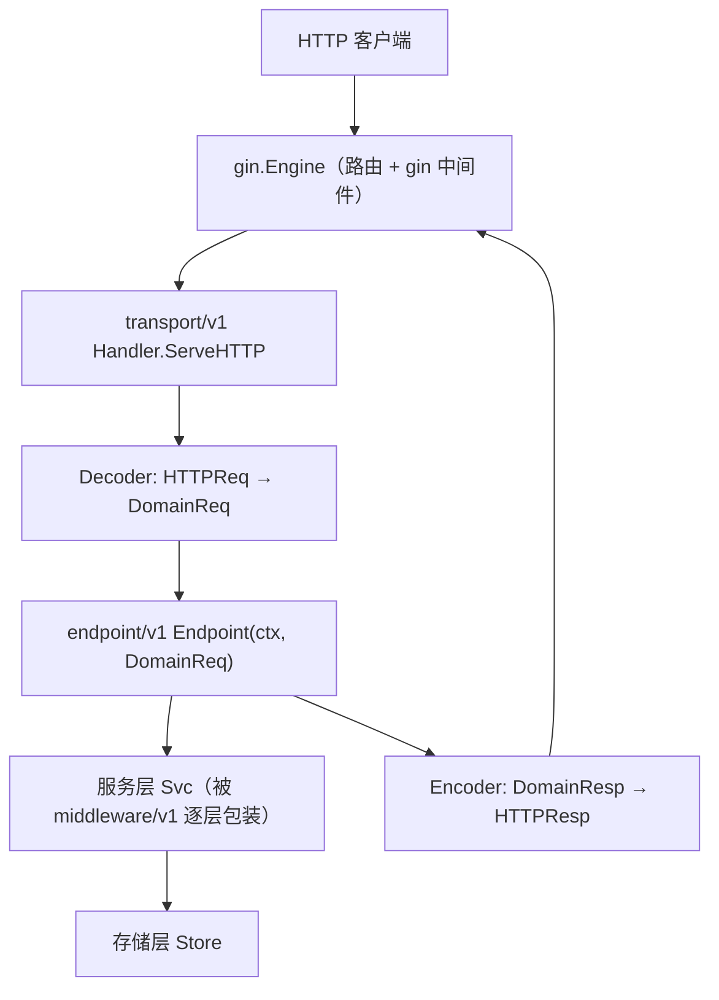

# generic_server framework/http：类型安全的 HTTP 分层框架

## 库定位与适用场景

`pkg/generic_server/framework/http` 提供 HTTP 服务端的三个分层契约包：
`endpoint/v1`（端点）、`middleware/v1`（服务中间件）、`transport/v1`（传输层
Decoder/Encoder/Handler）。设计参考 go-kit 的分层思想，用 Go 泛型在编译期固定
「HTTP 类型 ↔ 领域类型」的转换链路。

适用场景：

- 请求/响应均为 JSON 结构体的 API，希望解码、业务、编码三段各自独立可测；
- 服务层需要可插拔的装饰器式中间件（日志、鉴权等），由
  [generic_server/server](generic_server_server.md) 按配置顺序安装。

## 安装与导入路径

```bash
go get github.com/ClessLi/component-base
```

```go
import (
epv1 "github.com/ClessLi/component-base/pkg/generic_server/framework/http/endpoint/v1"
mwv1 "github.com/ClessLi/component-base/pkg/generic_server/framework/http/middleware/v1"
transportv1 "github.com/ClessLi/component-base/pkg/generic_server/framework/http/transport/v1"
)
```

## 核心概念与分层架构



- **传输层**持有 Decoder/Endpoint/Encoder，负责绑定 JSON、类型转换与写响应；
- **端点层**是纯业务函数签名，不感知 HTTP；
- **中间件层**包装的是**服务工厂**（`Svc`），不是 gin.HandlerFunc——gin 侧中间件
  （Recovery、metrics 等）由 generic server 直接安装。

## 关键类型与函数清单

### endpoint/v1/endpoint.go

| 签名                                                                                                                       | 说明               |
|--------------------------------------------------------------------------------------------------------------------------|------------------|
| `type Endpoint[DomainReq, DomainResp any] func(ctx context.Context, request DomainReq) (response DomainResp, err error)` | 端点函数：领域请求 → 领域响应 |

### middleware/v1/middleware.go

| 签名                                                     | 说明                                        |
|--------------------------------------------------------|-------------------------------------------|
| `type Middleware[Svc any] func(factory Svc) Svc`       | 服务工厂装饰器                                   |
| `type Middlewares[Svc any] map[string]Middleware[Svc]` | 具名中间件注册表，键供配置 `Middlewares []string` 按序引用 |

### transport/v1（decoder.go、encoder.go、handler.go）

| 签名                                                                                                                                                                                                              | 说明                              |
|-----------------------------------------------------------------------------------------------------------------------------------------------------------------------------------------------------------------|---------------------------------|
| `type Decoder[HTTPReq, DomainReq any] func(ctx context.Context, r HTTPReq) (DomainReq, error)`                                                                                                                  | HTTP 请求 → 领域请求                  |
| `type Encoder[DomainResp, HTTPResp any] func(ctx context.Context, r DomainResp) (HTTPResp, error)`                                                                                                              | 领域响应 → HTTP 响应                  |
| `type Handler[HTTPReq, HTTPResp any] interface { ServeHTTP(c *gin.Context) }`                                                                                                                                   | 传输层处理器接口（泛型参数仅作文档性标记，不出现在方法签名中） |
| `func NewHandler[HTTPReq, DomainReq, DomainResp, HTTPResp any](ep epv1.Endpoint[DomainReq, DomainResp], decoder Decoder[HTTPReq, DomainReq], encoder Encoder[DomainResp, HTTPResp]) Handler[HTTPReq, HTTPResp]` | 组装完整类型链路的处理器                    |

### ServeHTTP 的固定行为（handler.go L31-62）

| 阶段                                         | 失败响应                                  |
|--------------------------------------------|---------------------------------------|
| `c.ShouldBindJSON(&httpReq)` 绑定请求体         | `400` + `gin.H{"error": err.Error()}` |
| `decoder(c.Request.Context(), httpReq)`    | `400` + 同上                            |
| `endpoint(c.Request.Context(), domainReq)` | `500` + 同上                            |
| `encoder(c.Request.Context(), domainResp)` | `500` + 同上                            |
| 全部成功                                       | `200` + `c.JSON(httpResp)`            |

## 配置项说明

本框架三个包均为纯类型契约与构造器，**无 Options 结构、无默认值**。
中间件安装顺序、路由挂载由 [generic_server/server](generic_server_server.md) 的
`APIServerConfig.Middlewares` 与 `APIServerBizHooks.InitController` 决定。

## 最小可运行示例

```go
package main

import (
	"context"
	"net/http"

	epv1 "github.com/ClessLi/component-base/pkg/generic_server/framework/http/endpoint/v1"
	transportv1 "github.com/ClessLi/component-base/pkg/generic_server/framework/http/transport/v1"
	"github.com/gin-gonic/gin"
)

type echoHTTPReq struct {
	Message string `json:"message"`
}

type echoHTTPResp struct {
	Message string `json:"message"`
}

func main() {
	// 端点：纯业务函数
	var ep epv1.Endpoint[string, string] = func(ctx context.Context, req string) (string, error) {
		return req, nil
	}

	h := transportv1.NewHandler(
		ep,
		func(ctx context.Context, r echoHTTPReq) (string, error) { return r.Message, nil },
		func(ctx context.Context, s string) (echoHTTPResp, error) { return echoHTTPResp{Message: s}, nil },
	)

	r := gin.Default()
	r.POST("/echo", h.ServeHTTP)
	_ = http.ListenAndServe(":8080", r)
}
```

```bash
curl -X POST localhost:8080/echo -d '{"message":"hello"}'
# {"message":"hello"}
```

## 进阶示例

### 服务中间件（真实示例）

改写自 [examples/apiserver/middleware.go](../../../../examples/apiserver/middleware.go)，
以 [methodlog](methodlog.md) 包装服务工厂：

```go
func GetMiddlewares() mwv1.Middlewares[ServiceFactory] {
return mwv1.Middlewares[ServiceFactory]{
"logging": loggingMiddleware,
}
}

func loggingMiddleware(next ServiceFactory) ServiceFactory {
return &loggingService{next: next}
}
```

配置 `Middlewares: []string{"logging"}` 后，generic server 在初始化时按序执行
`svc = mw(svc)`，见 [examples/apiserver/hooks.go](../../../../examples/apiserver/hooks.go)
的 `RegisteredMiddlewares`。

### 与手写 controller 并存

[examples/apiserver](../../../../examples/apiserver/controller.go) 的 REST 路由
（GET/查询参数场景）采用手写 gin controller + [core.WriteResponse](core.md)，
与本框架的 JSON-body Handler 并存于同一 `gin.Engine`，按请求形态选用。

## 与其他库的协作关系

- **[generic_server/server](generic_server_server.md)**：`GenericAPIServer` 消费
  `Middlewares[Svc]` 并在 `InitController` 中挂载路由；本框架不管理生命周期。
- **[methodlog](methodlog.md)**：示例的服务中间件用其实现统一方法日志。
- **[core](core.md) / [errors](errors.md)**：手写 controller 路径用 core 按 Coder
  写状态码；本框架 Handler 的错误响应**不经过** Coder（见注意事项 2）。

## 注意事项、限制与常见问题

1. **仅适用 JSON 请求体**：`ServeHTTP` 固定 `ShouldBindJSON`，GET/无 body 请求会因
   EOF 绑定失败返回 400。查询参数、路径参数场景请手写 controller（如 examples/apiserver）。
2. **错误状态码固定**：decoder 失败一律 400、endpoint/encoder 失败一律 500，
   响应体为 `{"error": "..."}`；不读取 errors Coder 的 `HTTPStatus()`。需要按错误码
   映射状态码时，在 endpoint 内自行写响应或改用手写 controller + core.WriteResponse。
3. **Handler 泛型参数不参与约束**：`Handler[HTTPReq, HTTPResp]` 的方法签名不含泛型
   参数，类型安全由 `NewHandler` 的四参数链路在构造期保证。
4. **中间件包装服务工厂而非 HTTP handler**：安装顺序即包裹顺序（先安装的在内层），
   与 gin 中间件是两套机制。
5. **无内置 gin 中间件**：Recovery、metrics、healthz 由 generic server 安装，
   本框架不提供。